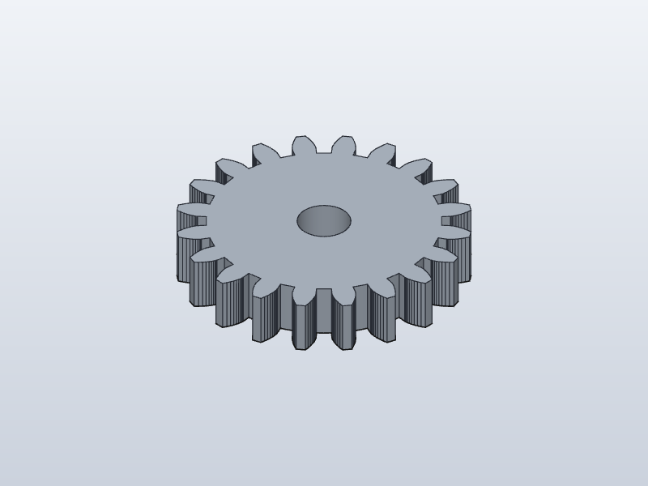

# solidcraft-plugin-gear



A [SolidCraft](https://github.com/tangency-labs/solidcraft) plugin that creates a
parametric involute spur gear at the origin of a design.

The plugin is a WebAssembly component against the plugin contract the merged
SolidCraft host serves: world `craft:plugin@0.1.0`, capability
`commands@0.1` (phase 1 of
[RFC 0002](https://github.com/tangency-labs/solidcraft/blob/main/docs/rfcs/0002-plugins.md),
merged in [#15112](https://github.com/tangency-labs/solidcraft/pull/15112)). It
changes the model only through the engine commands the app already serves over
MCP (`sketch.line`, `sketch.arc.center_point`, `sketch.circle.center`,
`solid.extrude`), so every edit is undoable and journaled, and a design the
plugin made **opens without the plugin installed**.

## Status

SolidCraft merged the phase 1 wasm host (PR #15112). This plugin is ported to
that contract: its static manifest is parsed by `craft-plugin`, and the tests
run the component through the real `craft-plugin-wasm` sandbox (fresh instance,
fuel, transaction commit and rollback). The geometry and the emitted commands
are verified against the current engine through its MCP surface. When a
SolidCraft release ships the host, drop the folder from a release into your
plugins folder and it will run. Until then, use the CLI route below.

## Use it today, before the app's plugin host exists

The installed SolidCraft ships `solidcraft-cli.exe`, which runs the same engine
the app does. You can drive the plugin's wasm component yourself and replay its
commands into a real design file:

```sh
rustup target add wasm32-unknown-unknown
cargo build --release --target wasm32-unknown-unknown

# Run the component on the real plugin host, dump the engine commands for any parameters:
cargo run --example dump_commands -- gear.json teeth=31 module=3 thickness=12 bore_diameter=10 name=Pinion

# Replay them with the app's own engine and save an openable design:
"C:\Program Files\SolidCraft\solidcraft-cli.exe" run gear.json --save gear.sc
```

Open `gear.sc` in SolidCraft: the gear is there, as native sketch and extrude
features in the timeline, fully undoable. `solidcraft-cli snapshot --in gear.sc
--out shot.png --view iso` renders it without opening the app.

## Install (when the plugin host is available)

1. Download `gear-generator-<version>.zip` from the project's
   [releases](../../releases) (or build it from source, see below).
2. Unpack it into the plugins folder:

   | System | Plugins folder |
   |---|---|
   | Windows | `%LOCALAPPDATA%\SolidCraft\plugins\gear-generator\` |
   | macOS | `~/Library/Application Support/SolidCraft/plugins/gear-generator/` |
   | Linux | `~/.local/share/solidcraft/plugins/gear-generator/` |

   The folder must hold `plugin.json` and `gear-generator.wasm`.
3. Restart SolidCraft. The plugin appears under Preferences › Plugins.

## Parameters

| Parameter | Range | Default | Meaning |
|---|---|---|---|
| `teeth` | 6 – 200 | 20 | Number of teeth |
| `module` | 0.5 – 20 mm | 2 mm | Pitch diameter = module × teeth |
| `pressure_angle` | 10° – 30° | 20° | At the pitch circle (14.5°, 20° and 25° are the common values) |
| `thickness` | 1 – 300 mm | 8 mm | Face width (extrude distance) |
| `bore_diameter` | 0 – 400 mm | 8 mm | Centre bore, 0 for none; must leave a rim |
| `name` | 1 – 64 chars | `Gear` | Name of the sketch, the extrude and the body |

The gear is centred on the origin on the XY plane and extruded towards +Z.
Above the root circle each flank is a 12-piece involute approximation; below
the base circle (gears under about 17 teeth) it is a straight radial line, the
standard simplified profile. Root fillets and undercut trimming are not modelled.

## What the plugin emits

One `sketch.create`, then per tooth: the two flanks as polylines, the tip arc on
the tip circle and the root arc on the root circle, then the bore circle, then
`sketch.finish` and one `solid.extrude`. For 20 teeth that is 84 engine
commands in one undo step, and the summary the plugin returns carries the
pitch, tip and root diameters, a volume estimate and the bounding box, so an
agent or the host can check the result with `measure`.

## Build from source

```sh
rustup target add wasm32-unknown-unknown
cargo build --release --target wasm32-unknown-unknown
# target/wasm32-unknown-unknown/release/solidcraft_plugin_gear.wasm is a core
# module carrying component metadata; lift it into the component:
wasm-tools component new target/wasm32-unknown-unknown/release/solidcraft_plugin_gear.wasm \
  -o gear-generator/gear-generator.wasm
```

Then stage the folder:

```sh
mkdir -p gear-generator
cp plugin.json README.md gear-generator/
wasm-tools component new target/wasm32-unknown-unknown/release/solidcraft_plugin_gear.wasm \
  -o gear-generator/gear-generator.wasm
```

Run the tests on the host target:

```sh
cargo test
cargo clippy --all-targets -- -D warnings
```

## Repository layout

| Path | What it is |
|---|---|
| `plugin.json` | The manifest: metadata, the `commands@0.1` capability, the runtime block (module, entries with input schemas, declared commands) |
| `wit/plugin.wit` | The plugin world `craft:plugin@0.1.0` the merged host serves |
| `src/gear.rs` | Involute geometry: radii, the closed outline, area and volume estimates |
| `src/contract.rs` | The entry's input schema and the input validation |
| `src/commands.rs` | The engine command list the plugin emits and the result summary |
| `src/lib.rs` | The WIT bindings and the `execute` loop |
| `src/tests.rs` | Unit tests, including volume checks against values the real engine measured |
| `tests/host.rs` | The component run through the real `craft-plugin`/`craft-plugin-wasm` host |

## License

[MIT](LICENSE).
